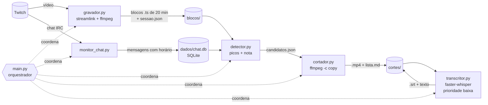

# Cortes automáticos de lives

Programa em Python que grava uma live da Twitch, acompanha o chat ao mesmo tempo
e, quando o chat explode, salva sozinho o trecho do vídeo daquele momento como um
corte pronto para editar, com transcrição e legenda `.srt`.

Tudo roda no notebook, no processador (sem placa de vídeo), e foi feito para
funcionar **em segundo plano** enquanto eu uso o computador para editar no CapCut.

> O programa **não posta nada** em redes sociais. Ele só encontra e separa os
> momentos; quem decide o que vai ao ar sou eu.

## O problema

Quem faz cortes de live precisa assistir horas de transmissão para achar poucos
minutos que valem a pena. Encontrar o momento, voltar o vídeo, marcar início e
fim e exportar toma mais tempo do que editar o corte.

O chat resolve a parte difícil: quando algo engraçado, assustador ou surpreendente
acontece, centenas de pessoas reagem nos mesmos segundos. O programa mede esse
volume, compara com o "normal" daquela live e trata cada explosão como um
candidato a corte.

## Como funciona



| Etapa | Arquivo | O que faz |
|---|---|---|
| 1 | `gravador.py` | Grava a live em blocos `.ts` de 20 min. Reconecta se a conexão cair, anota a hora real de início de cada trecho e os intervalos de anúncio, e para sozinho quando a live acaba ou o disco está quase cheio. |
| 2 | `monitor_chat.py` | Entra no chat da Twitch como visitante anônimo (só leitura) e salva cada mensagem com o horário de chegada no SQLite. |
| 3 | `detector.py` | Conta mensagens em janelas de 10 s. Um pico é uma janela com pelo menos 3x a média dos 5 min anteriores. Picos próximos viram um só momento, com uma nota de 0 a 10. |
| 4 | `cortador.py` | Converte o horário do momento em "qual bloco, de que segundo a que segundo" e extrai o trecho sem recodificar. Gera também uma `lista.md` com os cortes. |
| 5 | `transcritor.py` | Transcreve só os cortes, com o modelo Whisper `small` no processador, e gera a legenda `.srt`. |
| 6 | `main.py` | Roda tudo junto, chama o detector a cada 5 min e sempre que um bloco fecha, mostra uma notificação do Windows a cada corte novo e impede o notebook de suspender. |

### A nota de cada momento

| Parte | Até | Como é medida |
|---|---|---|
| Volume | 6 | Quantas vezes o chat ficou acima do normal (3x ≈ 3,2 pontos; 8x = 6). |
| Duração | 1,5 | Picos que se mantêm por várias janelas seguidas valem mais. |
| Reações | 2,5 | % das mensagens com palavras como `KKK`, `KEKW`, `CLAP`, `MDS`. |

Com nota a partir de `NOTA_MINIMA_AUTOCORTE` (4.0), o corte é salvo sozinho.

O corte começa 45 s antes do pico, porque o chat reage com atraso. Ele termina
quando o chat volta ao normal por 30 s seguidos (fim dinâmico), com no mínimo 60 s
e no máximo 3 min.

## Tecnologias

- **Python 3.13**, quase só com a biblioteca padrão (`sqlite3`, `socket`, `threading`, `subprocess`, `ctypes`)
- **[Streamlink](https://streamlink.github.io/)**: pega o vídeo da live
- **[FFmpeg](https://ffmpeg.org/)**: grava em blocos e extrai os cortes
- **SQLite** (modo WAL): guarda o chat
- **[faster-whisper](https://github.com/SYSTRAN/faster-whisper)**: transcrição no processador (`int8`)
- **psutil**: deixa a transcrição em prioridade baixa

## Instalação (Windows)

1. Instale o Python 3.13, o FFmpeg e o Streamlink. Depois feche e abra o PowerShell para os comandos aparecerem.

   ```powershell
   winget install Python.Python.3.13
   ```

   ```powershell
   winget install Gyan.FFmpeg
   ```

   ```powershell
   winget install Streamlink.Streamlink
   ```

2. Clone o repositório e crie o ambiente virtual:

   ```powershell
   git clone https://github.com/Gustavobc011/cortes-automaticos.git
   ```

   ```powershell
   cd cortes-automaticos
   ```

   ```powershell
   python -m venv venv
   ```

   ```powershell
   .\venv\Scripts\pip install -r requirements.txt
   ```

   O modelo do Whisper (uns 500 MB) é baixado sozinho na primeira transcrição.

## Uso

Com a live no ar:

```powershell
.\venv\Scripts\python main.py nomedocanal
```

Também aceita o link (`https://www.twitch.tv/nomedocanal`). Ctrl+C encerra tudo
de forma limpa. No fim aparece um resumo, e o programa pergunta se pode apagar a
gravação bruta. Os cortes ficam.

O que fica no disco:

```
blocos/<canal>_<data>/   bloco_000.ts ... + sessao.json + candidatos.json   (gravação bruta)
cortes/<canal>_<data>/   01_19h21_nota4.2.mp4 + .srt + cortes.json + lista.md
dados/chat.db            todas as mensagens do chat
```

Cada etapa também roda sozinha, o que ajuda a testar ou refazer uma parte:

| Comando | O que faz |
|---|---|
| `python gravador.py canal` | só grava |
| `python monitor_chat.py canal` | só salva o chat |
| `python detector.py [sessao]` | mostra a tabela de candidatos de uma gravação |
| `python cortador.py 3 5 --sessao <pasta>` | corta os candidatos 3 e 5 à mão, com qualquer nota |
| `python transcritor.py [pasta] [--todos]` | transcreve os cortes que faltam |

Todas as configurações (nota mínima, margens, palavras de reação, tamanho dos
blocos, modelo do Whisper) ficam comentadas em [`config.py`](config.py).

## Decisões técnicas

### Por que transcrever só os picos

Sem placa de vídeo, o Whisper é lento e pesado. Transcrever uma live inteira de
4 h deixaria o notebook ocupado por horas, e a maior parte do texto nunca seria
lida. O chat já diz
onde estão os bons momentos, então só os cortes (1 a 3 min cada) são transcritos,
depois de salvos.

### Por que gravar em blocos `.ts`

- **Resiste a falhas:** o formato MPEG-TS é feito para transmissão. Se o programa
  ou o notebook cair, tudo o que já foi gravado continua legível, ao contrário de
  um `.mp4`, que só fica válido quando é fechado.
- **Cortes durante a live:** blocos de 20 min permitem cortar enquanto a live
  ainda está rolando. Quando um bloco fecha, os cortes dele já podem sair.
- **Espaço em disco:** dá para apagar a gravação bruta aos poucos.
- **Horários exatos:** o ffmpeg anota em um CSV o início e o fim de cada bloco.
  Somando isso à hora real do primeiro byte de vídeo, cada segundo do vídeo tem
  um horário real, e é isso que liga o vídeo ao chat.

### Por que `-c copy`

O `-c copy` copia o vídeo e o áudio como estão, sem recodificar.
- **Gravação:** usa quase nada de CPU, o que é essencial para gravar horas
  enquanto o notebook é usado para outra coisa.
- **Cortes:** um corte de 3 min sai em poucos segundos, sem perder qualidade.

O preço é que o corte só pode começar num keyframe, e a live tem um a cada 2 s.
Por isso o corte leva 3 s extras de cada lado. Na junção entre dois blocos perdem-se
uns 2 quadros (60 ms), imperceptível num corte que vai ser editado.

### Por que usar o chat como sinal

- **Leve:** analisar o vídeo ou o áudio com IA durante a live pesaria demais num
  processador de notebook. Contar mensagens custa quase nada.
- **Mede o que importa:** o chat é a reação do público, que é justamente o que
  faz um corte funcionar.
- **Compara com o próprio canal:** o "normal" é a média móvel dos últimos 5 min,
  então o mesmo código serve para um canal com 50 ou com 5 000 mensagens por
  minuto e se adapta quando o chat esquenta ao longo da live.
- **Ajustado com uma live real:** no teste de 70 min no canal do cellbit, o
  melhor momento foi de suspense ("MONKA", "MEDO") e teve nota 4.2, enquanto
  momentos com mais emotes de risada ficaram com notas maiores. Por isso a nota
  mínima ficou baixa e o fim do corte passou a seguir o chat. Os detalhes
  estão no histórico de commits.

### Como o programa convive com outros programas

- **Gravação:** só copia bytes (`-c copy`), sem recodificar.
- **Transcrição:** roda num processo separado, com prioridade "abaixo do normal" e
  só metade dos núcleos. O CapCut sempre tem preferência.
- **Suspensão:** enquanto o programa roda, ele pede ao Windows para não suspender
  o notebook (`SetThreadExecutionState`), e esse pedido é retirado no fim. A tela
  pode apagar normalmente.
- **Ctrl+C:** streamlink, ffmpeg e o transcritor rodam em grupos de processo
  próprios, então o Ctrl+C chega só ao Python, que encerra cada um em ordem sem
  corromper o último bloco.
- **Avisos:** cada corte novo aparece como notificação do Windows, sem precisar
  olhar o terminal.

## Limitações conhecidas

- O chat só funciona com a Twitch. O gravador também aceita YouTube e Kick, mas sem o chat não há detecção.
- Momentos que o chat não percebe (uma fala boa num chat calmo) não viram corte.
- A nota foi calibrada com poucas lives. Cada canal reage de um jeito, então a nota mínima e as palavras de reação podem precisar de ajuste.
